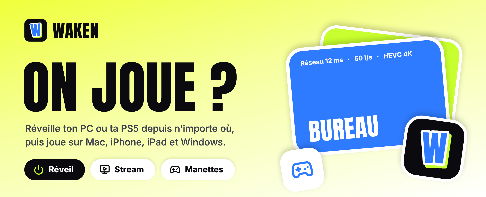
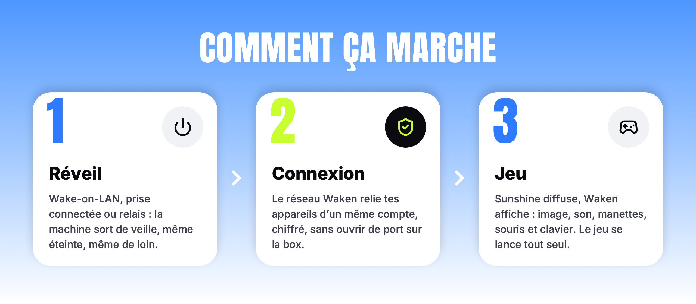
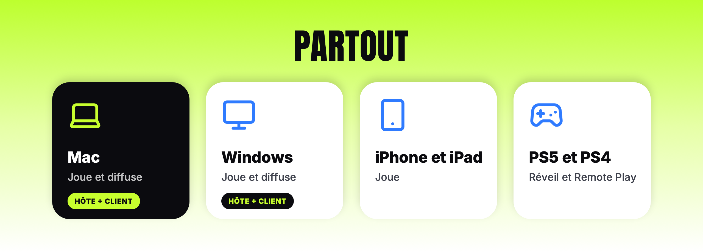
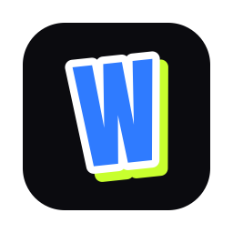

<p align="center">
  
</p>

<p align="center">
  <b>Réveille ton PC ou ta PS5 depuis n’importe où, puis joue en streaming sur Mac, iPhone, iPad et Windows.</b><br>
  Une seule app par appareil. Rien d’autre à installer.
</p>

<p align="center">
  
  
  
  
</p>

<p align="center">
  
  
  
  
  
</p>

<p align="center">
  
</p>

## Ce que fait Waken

Waken réunit dans une seule app ce qu’il faut d’habitude assembler soi-même : un serveur de stream, un client, un VPN,
un outil de réveil et un lanceur de jeux.

<table>
  <tr>
    <td width="50%" valign="top">
      <h3>Réveil à distance</h3>
      Wake-on-LAN sans relais : chaque machine laisse son adresse sur le serveur, et le paquet part de l’appareil
      qui veut jouer, vers la box (redirection UDP 9) ou via une autre machine Waken allumée. Sinon, prise
      connectée Shelly ou relais du homelab. Sur Windows, Waken démarre avec le PC, écran de connexion compris.
    </td>
    <td width="50%" valign="top">
      <h3>Stream</h3>
      Sunshine est embarqué dans les apps Mac et Windows, le client est écrit avec moonlight-common-c.
      Le jeu se lance tout seul. Un HUD discret montre où passe le temps de chaque image, et « Fluidité »
      garde une petite réserve d’images quand le réseau est irrégulier (5G).
    </td>
  </tr>
  <tr>
    <td width="50%" valign="top">
      <h3>Bibliothèque</h3>
      Les jeux installés sont trouvés seuls (Steam, Epic, GOG, apps Mac), avec leurs pochettes (SteamGridDB, Steam).
      La bibliothèque passe par le serveur Waken : on la parcourt depuis n’importe quel appareil, même quand la
      machine dort.
    </td>
    <td width="50%" valign="top">
      <h3>Manettes</h3>
      Xbox, DualSense et DualShock 4, avec vibrations, gâchettes, gyroscope, pavé tactile, LED et batterie.
      GameController et CoreHaptics sur Mac et iPhone, SDL3 sur Windows. Une page Manettes pour tester et régler.
    </td>
  </tr>
  <tr>
    <td width="50%" valign="top">
      <h3>PS5 et PS4</h3>
      Liaison avec le code à 8 chiffres de la console, réveil et Remote Play sur le réseau local, grâce à
      chiaki-ng. Même écran de stream, même HUD.
    </td>
    <td width="50%" valign="top">
      <h3>Réseau Waken</h3>
      Les appareils d’un même compte se voient à travers un réseau chiffré (Tailscale embarqué, Headscale côté
      serveur). Aucun port de jeu à ouvrir, Sunshine et l’agent restent sur 127.0.0.1.
    </td>
  </tr>
</table>

## Comment ça marche

<p align="center">
  
</p>

```
 iPhone, iPad, Mac, PC                                Mac ou PC qui fait tourner le jeu
┌────────────────────┐   réseau Waken (chiffré)      ┌──────────────────────────────────┐
│ App Waken          │ ────────────────────────────▶ │ App Waken                        │
│  client du stream  │   stream sur 127.0.0.1        │  ├─ Sunshine        (127.0.0.1)  │
│  tunnel Waken      │   agent via le tunnel         │  ├─ Agent Waken     (127.0.0.1)  │
└────────────────────┘                               │  └─ tunnel Waken                 │
          │                                          └──────────────────────────────────┘
          │  compte, bibliothèque, adresse de réveil
          ▼
   api.wakenplay.fr  (comptes Waken + Headscale)
```

1. **Compte** : chaque appareil se connecte une fois au même compte Waken. Le serveur lui donne une clé d’appareil
   à usage unique pour rejoindre le réseau.
2. **Bibliothèque** : l’agent de chaque machine trouve les jeux, les ajoute à Sunshine et envoie la liste au serveur.
3. **Réveil** : un clic sur un jeu d’une machine endormie envoie le paquet magique, puis Waken attend l’agent et
   Sunshine.
4. **Stream** : l’agent lance le jeu, l’app ouvre la session. En chemin direct, pleine qualité. Via un relais (réseau
   à NAT dur), Waken passe seul en 720p.

## Partout

<p align="center">
  
</p>

| | Joue | Diffuse | Réveille | Manettes |
|---|:---:|:---:|:---:|:---:|
| **Mac** | ✓ | ✓ (Sunshine embarqué) | ✓ | ✓ |
| **Windows** | ✓ | ✓ (Sunshine embarqué) | ✓ (démarre avec Windows) | ✓ (SDL3) |
| **iPhone et iPad** | ✓ | | ✓ | ✓ |
| **PS5 et PS4** | | via Remote Play | ✓ | DualSense fusionnée |
| **Android** | plus tard | | | |

## Démarrer

```bash
git clone <ce dépôt> waken && cd waken
git submodule update --init --recursive   # moonlight-common-c, chiaki-ng, mbedtls, SDL
pnpm install                              # pnpm, jamais npm
```

<details>
<summary><b>Mac</b> : hôte et client</summary>

```bash
sh apps/macos/scripts/build.sh            # app React Native, Sunshine (vérifié), agent, tunnel, signature
open apps/macos/build/Waken.app
```

- Clé SteamGridDB (pochettes des jeux hors Steam) : `~/.config/waken/steamgriddb.key`, intégrée au build.
- Signature : certificat « Apple Development » s’il est présent, sinon ad hoc (macOS oublie alors les autorisations
  à chaque build).
- Au premier lancement, Waken demande l’enregistrement de l’écran et le contrôle du Mac (macOS 27.3 : « System &
  App Protection Override »), puis redémarre le serveur seul.

</details>

<details>
<summary><b>iPhone et iPad</b> : client</summary>

```bash
sh tunnel/build.sh                                       # réseau Waken pour iOS
cd apps/mobile/ios && LANG=en_US.UTF-8 pod install && cd ..
pnpm exec expo run:ios                                   # le module natif ne tourne pas dans Expo Go
```

| Geste pendant le stream | Effet |
|---|---|
| Toucher | Clic gauche |
| Glisser | Glisser-déposer |
| Appui long, ou toucher à deux doigts | Clic droit |
| Glisser à deux doigts | Molette |
| Bouton clavier | Clavier virtuel |

</details>

<details>
<summary><b>Windows</b> : hôte et client</summary>

```powershell
powershell -ExecutionPolicy Bypass -File apps\windows\scripts\build.ps1          # Release, installée et lancée
powershell -ExecutionPolicy Bypass -File apps\windows\scripts\build.ps1 -Debug   # avec Metro, pour développer
```

- Il faut une fois : Node.js 22+, pnpm, PowerShell 7, le SDK .NET 10 et Visual Studio 2022 avec « Développement
  Desktop en C++ ». Go est téléchargé s’il manque.
- **Démarrer avec Windows et réveil à distance** : un interrupteur dans Réglages (Windows demande la confirmation
  administrateur), ou `apps\windows\scripts\install-service.ps1` dans un PowerShell administrateur. L’agent,
  Sunshine et le réseau tournent alors dès l’allumage, et la carte réseau répond au paquet magique.
- Reste à activer le Wake-on-LAN dans le BIOS et, pour le réveil depuis Internet, une redirection UDP 9 sur la box.

</details>

<details>
<summary><b>Serveur</b> : comptes Waken et Headscale</summary>

- `server/Waken.Cloud` (ASP.NET Core Identity, SQLite) : comptes, `POST /network/join` (clé d’appareil à usage
  unique, 10 minutes), appareils du compte, bibliothèques (`PUT /library/{machine}`, `GET /library`), adresse
  publique pour le réveil, notifications APNs.
- Headscale v0.29.7 : un utilisateur par compte. La politique `server/headscale/policy.hujson` isole les comptes,
  et le tunnel le vérifie aussi de son côté.
- Déploiement avec Dokploy : `server/docker-compose.cloud.yml`, pas à pas dans [`server/DEPLOY.md`](server/DEPLOY.md).
- Adresses : `https://api.wakenplay.fr` (comptes) et `https://net.wakenplay.fr` (Headscale).

</details>

## Pendant le stream

Le bouton Waken, en haut à gauche, ouvre le menu du HUD :

| | |
|---|---|
| **Qualité** | Définition, débit et codec (H.264 ou HEVC) |
| **Fluidité** | Réserve d’images adaptative : aucune sur un réseau stable, jusqu’à 3 images en 5G |
| **Manettes** | Les manettes branchées, leur type annoncé, vibrations et gyroscope |
| **Statistiques** | Réseau, images par seconde, débit, encodage sur le PC, réception, jusqu’à l’écran, régularité, réserve |
| **Plein écran, son, clavier** | Selon l’appareil |
| **Quitter** | Le stream seulement : le jeu continue sur la machine |

## Le dépôt

```
apps/mobile            App Expo (SDK 58) : iPhone et iPad
apps/macos             App Mac (React Native macOS) : hôte et client
apps/windows           App Windows (React Native Windows) : hôte et client, scripts de build et de démarrage
packages/app           Écrans et logique partagés par les trois apps
packages/ui            Design system Waken (thème Arcade) : couleurs, Anton et Inter, icônes Lucide
packages/core          Appareils, méthodes de réveil, client de l’agent, compte PSN
modules/waken-stream   Module natif de stream : moonlight-common-c, VideoToolbox, manettes, chiaki-ng
modules/waken-tunnel   Module natif du réseau Waken pour l’iPhone
tunnel/                Réseau Waken (Go, Tailscale embarqué via tsnet)
agent/Waken.Agent      Agent (.NET 10) de la machine hôte : appairage Sunshine, jeux, pochettes, lancement, réveil
server/Waken.Cloud     Comptes Waken (.NET 10), bibliothèques, notifications
server/Waken.Api       API du homelab (.NET 10) : relais Wake-on-LAN, statut
server/headscale       Configuration de Headscale
docs/readme            Images de ce README (render.swift les redessine)
```

## Tests

```bash
pnpm test                                     # core, module natif, API, comptes et agent
pnpm typecheck
cd tunnel && .cache/go/bin/go test ./...      # réseau Waken
```

## État

| | |
|---|---|
| Stream iPhone → Mac à travers le réseau Waken (image, son, souris, clavier) | ✅ testé sur un vrai iPhone |
| Stream Mac → PC Windows, y compris en 5G | ✅ testé |
| Bibliothèque automatique et pochettes, via le serveur | ✅ testé sur Mac et PC |
| Chemin relayé (NAT dur) | ✅ 720p automatique |
| Démarrage avec Windows | ✅ activé sur le PC |
| Réveil d’un PC éteint par Wake-on-LAN | à tester (BIOS, box) |
| PS5 et PS4 (chiaki-ng) | écrit, jamais testé avec une console |
| Android | plus tard |

## Licences

Waken n’a pas encore de fichier de licence. Il s’appuie sur :

| Projet | Rôle | Licence |
|---|---|---|
| [moonlight-common-c](https://github.com/moonlight-stream/moonlight-common-c) | Client du stream | GPLv3 |
| [chiaki-ng](https://github.com/streetpea/chiaki-ng) | PS5 et PS4 | AGPLv3 |
| [Sunshine](https://github.com/LizardByte/Sunshine) | Serveur du stream (téléchargé et vérifié au build) | GPLv3 |
| [Mbed TLS](https://github.com/Mbed-TLS/mbedtls) | Chiffrement de chiaki-ng | Apache-2.0 |
| [SDL](https://github.com/libsdl-org/SDL) | Manettes sur Windows | zlib |
| [Tailscale (tsnet)](https://github.com/tailscale/tailscale) et [Headscale](https://github.com/juanfont/headscale) | Réseau Waken | BSD-3-Clause |

Une app distribuée avec chiaki-ng doit l’être sous AGPLv3, code source compris.

<p align="center">
  <br>
  <br>
  <sub>On joue ?</sub>
</p>
